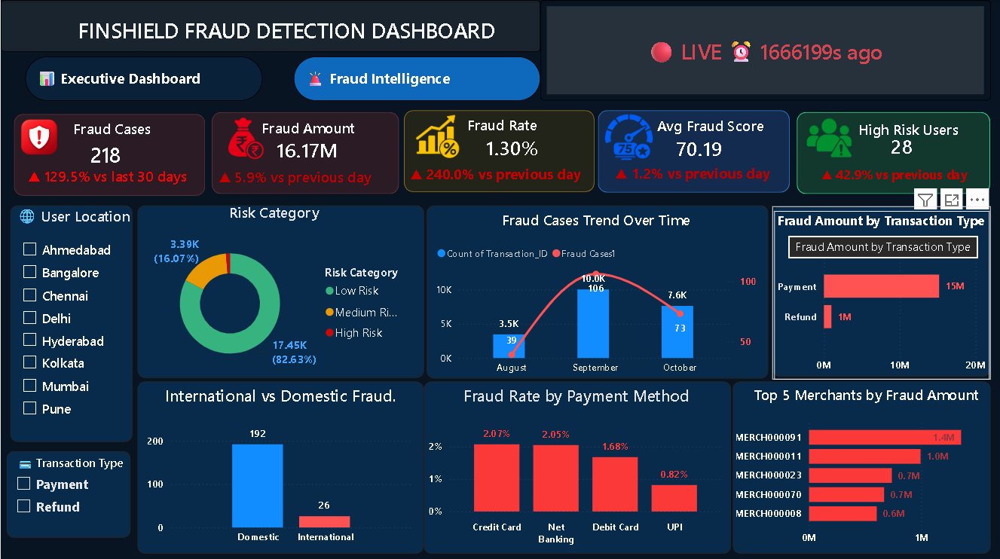

# FinShield Fraud Detection System

A Financial Transaction Analysis and Fraud Monitoring Project using Python, MySQL, SQL, and Power BI.

## Project Overview

FinShield is a data analytics project that focuses on analyzing financial transactions and identifying potentially fraudulent activities using rule based fraud scoring.

The project combines Python for synthetic data generation, MySQL for database management, SQL for data analysis, and Power BI for interactive dashboards.

## Business Problem

Financial transactions can involve suspicious activities, unusual transaction patterns, and potential fraud.

FinShield analyzes transaction data to monitor financial performance, identify suspicious patterns, and provide useful insights through interactive dashboards.

## Project Objectives

- Generate synthetic financial transaction data.
- Analyze transaction patterns using Python and SQL.
- Identify potentially suspicious transactions using rule based scoring.
- Monitor fraud cases and fraud amounts.
- Analyze transaction success and failure rates.
- Build interactive Power BI dashboards.
- Support data driven business decisions.

## Technologies Used

| Technology | Purpose |
|---|---|
| Python | Data generation and processing |
| Pandas | Data manipulation |
| Faker | Synthetic data generation |
| SQLAlchemy | Database connectivity |
| MySQL | Data storage |
| SQL | Data analysis |
| Power BI | Dashboard development |
| DAX | KPI calculations |

## Project Architecture

```text
Python Data Generation
        |
        v
Synthetic Transaction Data
        |
        v
MySQL Database
        |
        v
SQL Queries and Analysis
        |
        v
Power BI Dashboard
        |
        v
Fraud Monitoring and Insights
```

## Database Design

The project contains eight database tables:

1. Customers
2. Merchants
3. Devices
4. Transactions
5. Fraud_Alerts
6. Live_Metrics
7. Daily_Aggregations
8. Compliance_Logs

## Fraud Detection Methodology

The project uses rule based fraud scoring to identify potentially suspicious transactions.

The analysis focuses on transaction characteristics and assigns risk scores to help monitor potentially risky activities.

Key analysis areas:

- Suspicious transaction identification
- Fraud risk score analysis
- High risk user monitoring
- Fraud amount analysis
- Payment method analysis
- Transaction success rate analysis

## Power BI Dashboards

The project contains two dashboard pages.

### 1. Executive Dashboard

Provides an overview of financial transaction performance.

**Key Performance Indicators:**

- Total Revenue
- Success Rate
- Fraud Cases
- Fraud Amount
- Fraud Rate


### 2. Fraud Intelligence Dashboard

Focuses on fraud monitoring and risk analysis.

**Key Performance Indicators:**

- Average Fraud Score
- High Risk Users
- Fraud Cases
- Fraud Amount
- Fraud Rate



## SQL Analysis

SQL queries are used to analyze transaction data and identify business patterns.

Analysis includes:

- Fraud by payment method
- Daily revenue trends
- Top merchants by revenue
- Customers with the highest transaction counts
- Success rate by payment method
- Fraud rate by payment method
- Successful transaction amount
- Top three merchants by state using CTEs and DENSE_RANK()

## Project Folder Structure

```text
fraud-detection-dashboard/
│
├── Dashboard_Screenshots/
│   ├── executive-dashboard.png
│   └── fraud-intelligence.png
│
├── Python/
│   ├── finShield_Fraud_Detection.ipynb
│   └── finShield_Fraud_Detection.py
│
├── powerbi/
│
├── sql/
│
├── README.md
├── LICENSE
└── .gitignore
```

## How to Run the Project

### Step 1: Clone the Repository

```bash
git clone https://github.com/ppoojitha76/fraud-detection-dashboard.git
```

### Step 2: Install Required Libraries

```bash
pip install pandas faker sqlalchemy pymysql
```

### Step 3: Configure MySQL

- Start your MySQL server.
- Create the required database.
- Configure your database connection.
- Execute the SQL scripts in the `sql` folder.

### Step 4: Run Python

Open and execute the Python notebook or script in the `Python` folder.

### Step 5: Open Power BI

Open the Power BI report from the `powerbi` folder and configure the database connection if required.

## Business Value

FinShield demonstrates how data analytics can help businesses:

- Monitor financial transaction performance.
- Identify potentially suspicious transactions.
- Track fraud related KPIs.
- Analyze payment methods and merchant performance.
- Understand transaction trends through dashboards.

## Project Limitations

- Uses synthetic transaction data.
- Fraud identification is based on rule based scoring.
- Designed for analytical demonstration and learning.
- Not intended as a production ready fraud detection system.

## Author

**CH Poojitha**

Aspiring Data Analyst

**Skills:** SQL | Python | Power BI | MySQL | Excel

**GitHub:** [ppoojitha76](https://github.com/ppoojitha76)

**Project Repository:** [FinShield Fraud Detection System](https://github.com/ppoojitha76/fraud-detection-dashboard)

---

*FinShield Fraud Detection System | Data Analytics Project*
