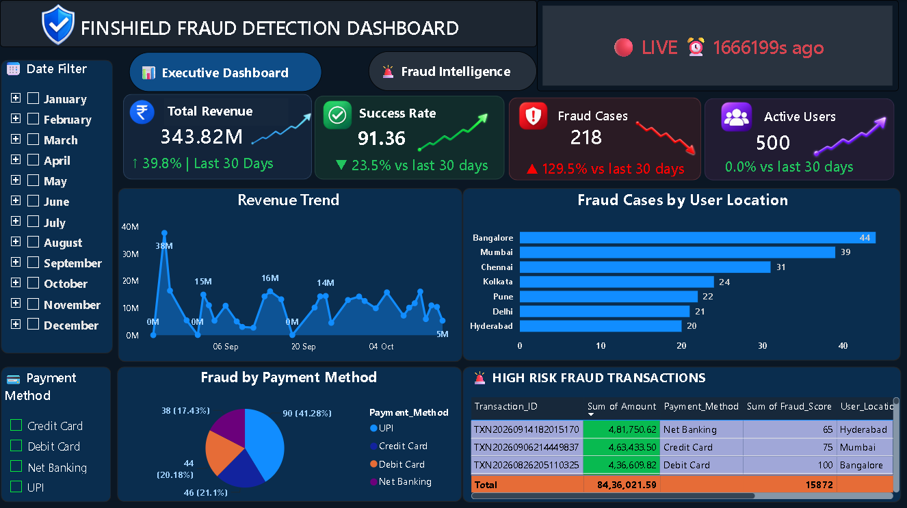

# FinShield | Fraud Detection & Analytics Dashboard

An end-to-end financial transaction analysis project using Python, SQL, MySQL, and Power BI to monitor transaction performance, identify suspicious activities, and analyze fraud risk.

---

## Project Overview

FinShield is a financial fraud analytics project designed to analyze financial transactions and identify potentially suspicious activities using rule-based fraud scoring.

The project combines Python for data generation and processing, MySQL for database management, SQL for data analysis, and Power BI for interactive dashboards.

**Note:** This project uses synthetic financial data. It does not contain real customer banking information or use a trained machine learning model.

---

## Business Objectives

- Analyze financial transaction trends and performance.
- Identify potentially suspicious transactions.
- Monitor fraud cases and high-risk transactions.
- Analyze transaction patterns across customers and merchants.
- Track important business performance indicators.
- Present insights through interactive dashboards.

---

## Technologies Used

| Technology | Purpose |
|---|---|
| Python | Data generation and processing |
| Pandas | Data cleaning and manipulation |
| NumPy | Numerical operations |
| MySQL | Database storage |
| SQL | Data analysis and investigation |
| Power BI | Interactive dashboards |
| DAX | KPI calculations and measures |
| Power Query | Data transformation |

---

## Project Workflow

1. Generated synthetic financial transaction data using Python and Pandas.
2. Cleaned and prepared the data for analysis.
3. Created relational tables in MySQL.
4. Stored customer, merchant, transaction, and fraud alert information.
5. Used SQL queries, joins, and aggregations to investigate transaction patterns.
6. Applied rule-based scoring to flag potentially suspicious transactions.
7. Connected the data to Power BI.
8. Developed interactive dashboards to monitor transaction performance and fraud risk.

---

## Dashboard Screenshots

### 1. Executive Dashboard



### 2. Fraud Analysis Dashboard


---

## Key Performance Indicators (KPIs)

- Total Transaction Amount
- Total Number of Transactions
- Successful Transactions
- Transaction Success Rate
- Fraud Cases
- High-Risk Transactions
- Fraud Risk Distribution
- Merchant Performance
- Payment Method Analysis

---

## Database Structure

| Table Name | Description |
|---|---|
| Customers | Customer information |
| Merchants | Merchant information |
| Transactions | Financial transaction records |
| Fraud Alerts | Potentially suspicious transaction alerts |

---

## SQL Analysis

SQL was used to investigate transaction patterns through:

- INNER JOIN
- LEFT JOIN
- GROUP BY
- HAVING
- Aggregate functions
- Subqueries
- Common Table Expressions (CTEs)
- Window functions
- Transaction trend analysis
- Fraud risk analysis

---

## Fraud Detection Approach

The project uses rule-based fraud scoring to identify transactions that may require further investigation.

The scoring approach considers:

- Transaction amount
- Customer risk
- Merchant risk
- International transaction activity

These rules help classify potentially suspicious transactions for further analysis.

**Important:** A flagged transaction is not necessarily confirmed fraud. The scoring rules are analytical indicators, not a guarantee of fraudulent activity.

---

## How to Run the Project

### Prerequisites

Make sure you have installed:

- Python
- Git
- MySQL Server
- MySQL Workbench
- Power BI Desktop

### Step 1: Clone the Repository

Open your terminal or command prompt and run:

### Step 1: Clone the Repository

```bash
git clone https://github.com/ppoojitha76/fraud-detection-dashboard.git
```

### Step 2: Navigate to the Project Folder

```bash
cd fraud-detection-dashboard
```

### Step 3: Verify Project Files

```bash
dir
```

### Step 4: Install Python Libraries

```bash
pip install pandas numpy sqlalchemy pymysql
```
### Step 5: Configure MySQL

1. Start MySQL Server.
2. Open MySQL Workbench.
3. Create the project database.
4. Import or generate the project data.
5. Configure your database connection.

**Example MySQL connection code:**

```python
from sqlalchemy import create_engine
import os

username = os.getenv("DB_USER")
password = os.getenv("DB_PASSWORD")
database = "finshield_fraud_detection"

connection_string = (
    f"mysql+pymysql://{username}:{password}"
    f"@localhost:3306/{database}"
)

engine = create_engine(connection_string)
```

**Security:** Store database credentials in environment variables. Never upload passwords to GitHub.

### Step 6: Run Python Scripts

Run the data generation and processing scripts from your project folder.

```bash
python your_script_name.py
```

Replace `your_script_name.py` with the actual Python filename in your repository.

### Step 7: Open the Power BI Dashboard

1. Open your `.pbix` file in Power BI Desktop.
2. Configure the MySQL connection if required.
3. Refresh the data.
4. Explore the dashboard using filters and visuals.

---

## Dataset Information

This project uses synthetic financial transaction data generated for educational and analytical purposes.

The dataset does not contain real customer identities, banking information, or actual financial transactions.

Synthetic data helps analyze transaction patterns and potentially suspicious activities without exposing private financial information.

---

## Key Learning Outcomes

- Python data generation and processing.
- Data cleaning and manipulation using Pandas.
- Relational database management using MySQL.
- SQL querying and analytical problem-solving.
- Rule-based fraud risk analysis.
- Power BI dashboard development.
- DAX measures and KPI reporting.
- End-to-end data analysis workflows.

---

## Future Improvements

- Add additional fraud detection rules.
- Improve transaction risk classification.
- Include more customer and merchant analysis.
- Explore machine learning models for fraud prediction.
- Add more interactive dashboard features.
- Improve dashboard performance and reporting.

---

## Author

**CH Poojitha**

Aspiring Data Analyst

**GitHub:**  
https://github.com/ppoojitha76

**LinkedIn:**  
https://www.linkedin.com/in/ch-poojitha-data-analyst

---

If you find this project useful, feel free to explore the repository.
